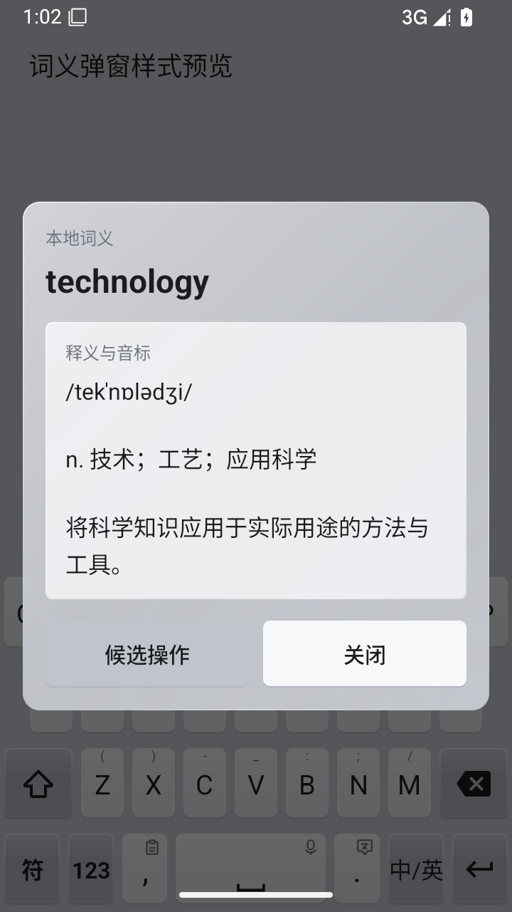
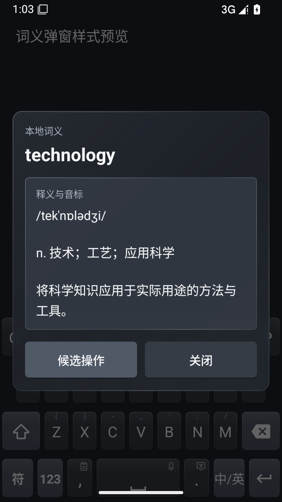

# 候选上滑英文与玻璃词义弹窗

2026-10-12 源码新增功能。本轮只上传源码，版本仍为 2.0.2；正式 [v2.0.2 下载 APK](https://github.com/pipi-433/pis-input-method/releases/tag/v2.0.2)不包含这两项更新。

## 顶部候选上滑英文

在顶部候选词上向上滑动，将该词的首条本地英文输入当前编辑框。例如：

| 中文候选 | 本地英文 |
|---|---|
| 技术 | technology |
| 建设 | to build |
| 基数 | cardinal number |
| 恶化 | to worsen |

英文来自本地词典映射。无可用英文映射时不提交文本，也不选中中文候选。点击仍选词，左右拖动仍浏览候选，静止长按仍打开词义弹窗。

编辑器拒绝写入英文时不清空候选；仅在接受写入后更新输入状态并清空组合输入。

手势在按下时捕获候选与输入状态，完成上滑并查询词典后核对候选、编辑器和选区。取消、长按或视图复用会结束旧上滑操作。

## 玻璃词义弹窗

长按候选打开词义弹窗。弹窗使用当前键盘的主题颜色、半透明渐变和玻璃边缘，支持浅色、深色和横屏；长释义可滚动，“候选操作”和“关闭”入口保留。

Android 12 / API 31 及以上在系统支持时启用原生背景模糊。系统关闭或不支持模糊时，面板使用更高不透明度的背景；模糊能力变化会动态调整面板。

以下为 API 35 模拟器中调试预览的实际组件截图：

| 浅色主题 | 深色主题 |
|---|---|
|  |  |

## 验证

Kotlin 编译与 11 项单元测试通过（46 秒），覆盖英文映射、手势判断、编辑器接受/拒绝写入时序和异常结束批次。模拟器实际触摸事件覆盖上滑一次、普通点击、无映射、横向/下滑/斜向、取消、候选复用和长按；真实 Fcitx 引擎检查 4 组英文映射、候选分页及 12 组零声母编码通过。

API 35 模拟器的实际弹窗与键盘预览检查覆盖浅/深色、横屏、长释义滚动、加载/空状态、关闭/候选操作回调，以及原生模糊和关闭后的背景切换。验证范围为候选视图事件、词典/引擎和弹窗预览；vivo 真机尚未验证。

项目当前状态见 [实现状态](../../PIS_MIGRATION_STATUS.md)，历史 APK 记录见 [2.0.2 发行说明](../releases/pis-2.0.2.md)。
